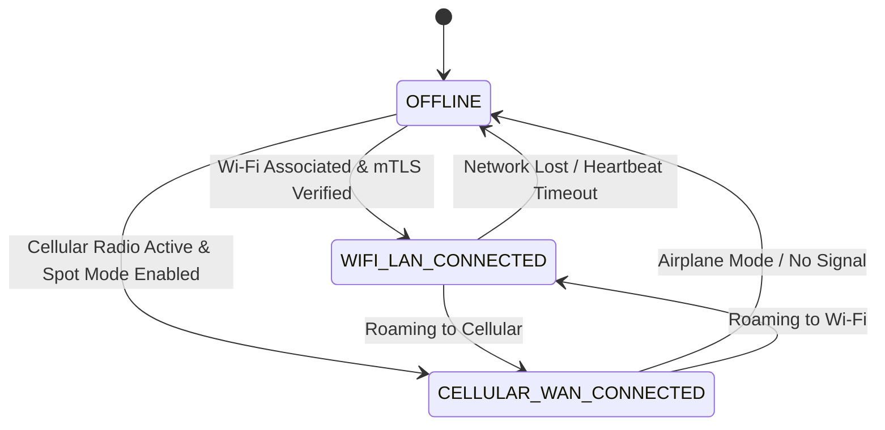
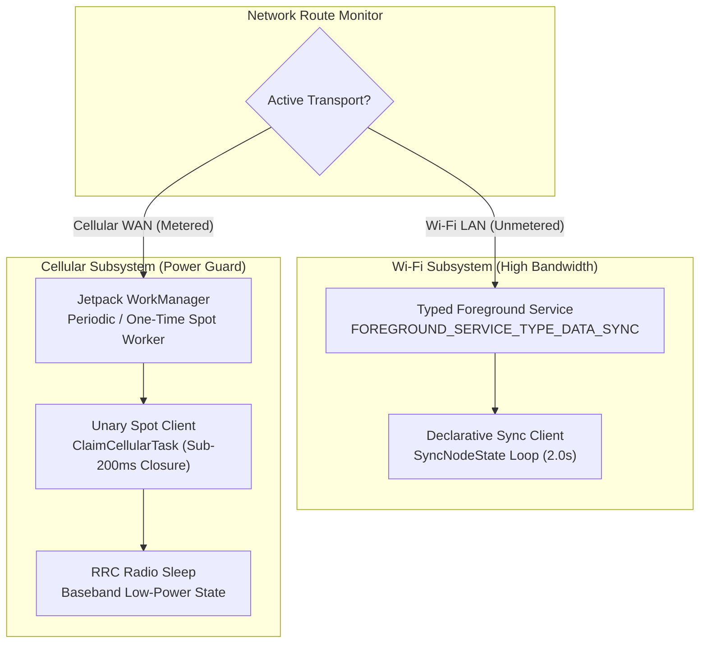
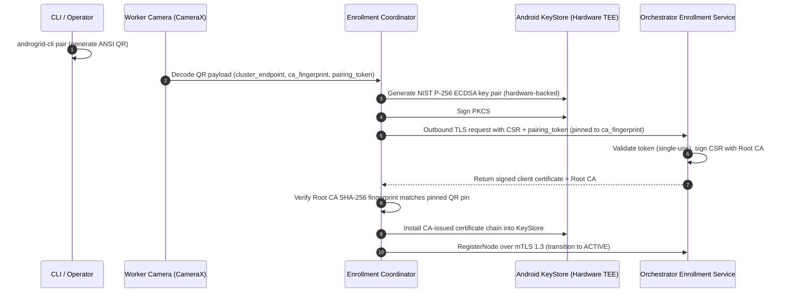

# Android Worker Architecture & State Machine Specification

This document details the internal architecture, lifecycle state machines, compute sandboxing, and background execution mechanisms of the **AndroGrid Android Worker Client** (`com.androgrid.worker`).

Traceability: `[REQ-OP-001]`, `[REQ-OP-002]`, `[REQ-OP-003]`, `[REQ-VER-001]`, `[REQ-VER-002]`, `[INV-001]`, `[INV-002]`, `[INV-003]`, `[NFR-POW-001]`.

---

## Architectural Principles & Master Invariants

The Android client is architected to operate efficiently on battery-powered mobile hardware while upholding strict platform and security invariants:

1. **[INV-001] Zero Inbound Mobile Ports:** The client never creates `ServerSocket` instances or listens on TCP/UDP ports. All communication initiates outbound toward the host control plane or Cloudflare Anycast ingress.
2. **[INV-002] Mutual TLS 1.3:** Every network socket strictly enforces mTLS with client certificate verification using modern Android `KeyStore` hardware-backed ECDSA P-256 keys.
3. **[INV-003] Zero Cellular Keepalive & Radio Sleep:** When operating over Cellular WAN, persistent sockets and heartbeats are prohibited (`[ANTI-001]`). Unary leases close within 200 ms (`[NFR-POW-001]`) to return the baseband modem to low-power Radio Resource Control (RRC) sleep.
4. **[REQ-VER-001] Typed Foreground Service (API 34+):** Android 14+ enforces typed foreground services. The worker invokes `ServiceCompat.startForeground` passing `FOREGROUND_SERVICE_TYPE_DATA_SYNC`.
5. **[REQ-VER-003] In-Memory W^X Sandbox:** WebAssembly bytecode executes in memory without emitting dynamic library shared objects (`.so`) to writable application storage.

---

## Section 6.1 Connection State Matrix

The worker dynamically adjusts its execution behavior based on active network transport interfaces and charging states:



### Connection State Matrix Details

| State Identifier | Network Transport | Interaction Mechanism | Heartbeat / Polling | Task Constraints |
| :--- | :--- | :--- | :--- | :--- |
| `STATE_OFFLINE` | None / Airplane | Disconnected | None | Tasks paused in local cache. |
| `STATE_WIFI_LAN_CONNECTED` | Unmetered Wi-Fi LAN | Persistent HTTP/2 `SyncNodeState` stream | Every 2.0 seconds (`[REQ-OP-002]`) | Can accept compute tasks of arbitrary duration; unmetered workloads allowed. |
| `STATE_CELLULAR_WAN_CONNECTED` | Metered Cellular WAN | Disconnected Unary `ClaimCellularTask` | Zero keepalive; socket closed within 200 ms | Spot leases only; max duration capped at 180 seconds (`[INV-005]`); unmetered tasks prohibited (`[ANTI-003]`). |

---

## Dual Execution Subsystems: Wi-Fi Loop vs WorkManager Cellular Spot

To balance responsiveness with battery longevity, the client divides background computation into two decoupled subsystems:



### 1. Wi-Fi Persistent Declarative Loop (`WifiSyncClient`)
- Active when connected to unmetered Wi-Fi.
- Managed by `WorkerForegroundService` with notification priority.
- Executes `SyncNodeState` every 2.0 seconds, synchronizing active task progress and fetching desired tasks.

### 2. Cellular Spot Worker (`CellularSpotWorker`)
- Implemented as a Jetpack `CoroutineWorker` scheduled with battery and charging constraints.
- Initiates an outbound unary RPC (`ClaimCellularTask`) requesting an available spot task lease.
- **200 ms Radio Sleep Enforcement (`[NFR-POW-001]`):** Immediately upon receiving `ClaimCellularTaskResponse`, the worker terminates the transport channel, allowing the cellular baseband modem to transition from high-power RRC connected state to idle sleep state.
- Executes compute workload locally in the background.
- Upon completion, opens a short-lived socket to invoke `SubmitCellularResult` and immediately shuts down again.

---

## Sandboxed Compute Engine Hierarchy

The Android worker executes tasks through isolated runtime engines based on device capabilities:

```text
+-------------------------------------------------------------+
|                 AndroGrid Compute Engine                    |
+-------------------------------------------------------------+
                              |
        +---------------------+---------------------+
        |                                           |
+-------------------------------+   +-------------------------------+
|  WebAssembly Sandbox Engine   |   |   Toybox Shell Engine         |
|      (EXECUTION_ENGINE_WASM)  |   |    (Unprivileged User CLI)    |
|  - Chicory Pure-JVM WASI P1   |   |  - Restricted to rooted dev   |
|  - In-Memory W^X Compliance   |   |  - Sanitized environment      |
|  - Zero native flash writes   |   |  - Strict execution timeout   |
+-------------------------------+   +-------------------------------+
```

### WebAssembly (WASI Preview 1) Runtime: Chicory
- Unrooted consumer devices run exclusively within the in-process WebAssembly sandbox (`[INV-006]`).
- The client integrates the **Chicory** zero-dependency WASM/WASI interpreter.
- Pure JVM/Android byte execution guarantees complete W^X memory protection compliance on Android 10+ without native compilation security violations (`[REQ-VER-003]`).
- Pre-cached bytecode artifacts downloaded over content-addressed URLs are verified via cryptographic SHA-256 before instantiation.

---

## Zero-Friction QR Code Enrollment & Hardware Keystore Provisioning

To eliminate manual PKCS#12 file transfers, the worker implements automated bootstrap enrollment via CameraX QR code scanning (`[REQ-OP-001]`, `[INV-002]`, `[NFR-SEC-001]`):



### Security Safeguards during Enrollment:
1. **Outbound-Only Invariant (`[INV-001]`):** Enrollment is initiated strictly from the mobile device to the orchestrator. No mobile listening ports are opened.
2. **Cryptographic Root CA Pinning (`[NFR-SEC-001]`):** The initial bootstrap TLS exchange validates the server certificate against the SHA-256 `ca_fingerprint` embedded directly in the scanned QR code, neutralizing rogue Wi-Fi Man-in-the-Middle (MITM) attacks.
3. **Hardware Key Isolation (`[INV-002]`):** Private keys are generated and anchored within the Android KeyStore (`AndroidKeyStore` provider). Key material is non-exportable and never serialized to persistent flash storage.
4. **Immediate Single-Use Invalidation:** The orchestrator invalidates the ephemeral pairing token immediately upon issuance, preventing token replay.

---

## Architecture Decision Records (ADRs)

For detailed design decisions and architectural trade-offs, consult the dedicated client ADRs:
* [ADR-001: Zero Inbound Listening Ports and Outbound-Only Mobile Networking](adr/ADR-001-zero-inbound-ports.md)
* [ADR-002: Cellular Radio Power Optimization and Fast Socket Teardown](adr/ADR-002-cellular-radio-power-optimization.md)
* [ADR-003: Typed Foreground Service (API 34+) and WorkManager Hybrid Background Lifecycle](adr/ADR-003-typed-foreground-service-and-workmanager.md)
* [ADR-004: In-Memory WebAssembly/WASI Execution without Dynamic Shared Library Disk Emission](adr/ADR-004-in-memory-wasm-wasi-execution.md)
* [ADR-005: Rooted Device Demarcation and Toybox User Sandbox Separation](adr/ADR-005-rooted-device-demarcation.md)
* [ADR-006: Protobuf Lite Schema Preservation and Hermetic R8 Obfuscation Contract](adr/ADR-006-r8-protobuf-schema-preservation.md)

---

## ISO/IEC/IEEE 29148 Traceability Matrix

For the complete bidirectional specification traceability matrix, refer to [traceability_matrix.md](traceability_matrix.md).

| Requirement Identifier | Architectural Role & Implementation Component | Verification Standard |
| :--- | :--- | :--- |
| `[REQ-OP-001]` | `RegisterNode` request construction (`DeviceCapabilityProvider`) & QR Code enrollment (`EnrollmentCoordinator`, `QrScannerActivity`) | Wire parity test & enrollment suite |
| `[REQ-OP-002]` | `SyncNodeState` declarative 2.0s synchronization loop (`WifiSyncClient`) | Unit & mock server tests |
| `[REQ-OP-003]` | Disconnected unary spot task lease over cellular WAN (`CellularSpotWorker`) | Robolectric cellular worker spec |
| `[REQ-VER-001]` | Typed foreground service type guard (`WorkerForegroundService`) | Android SDK compatibility test (API 28-34) |
| `[REQ-VER-002]` | Dynamic OS version and ABI reporting in capabilities (`DeviceCapabilityProvider`) | Capability reporting unit test |
| `[REQ-VER-003]` | W^X in-memory sandboxing with Chicory WASI runtime (`WasmEngine`) | WASM runtime verification test |
| `[INV-001]` | Zero listening inbound server sockets (`InboundPortGuardTest`) | Port inspection socket scanner |
| `[INV-002]` | Mutual TLS 1.3 with P-256 KeyStore keys (`MtlsSocketFactoryProvider`, `AndroidKeyStoreEnrollmentProvider`) | Handshake unit test |
| `[INV-003]` | Zero cellular keepalive and baseband radio sleep (`CellularSpotWorker`) | Channel teardown deadline test |
| `[NFR-SEC-001]` | Root CA SHA-256 fingerprint pinning during bootstrap enrollment (`BootstrapEnrollmentClient`) | Security violation hermetic unit test |
| `[NFR-POW-001]` | Channel termination within 200 ms of response receipt | Timing boundary test |
